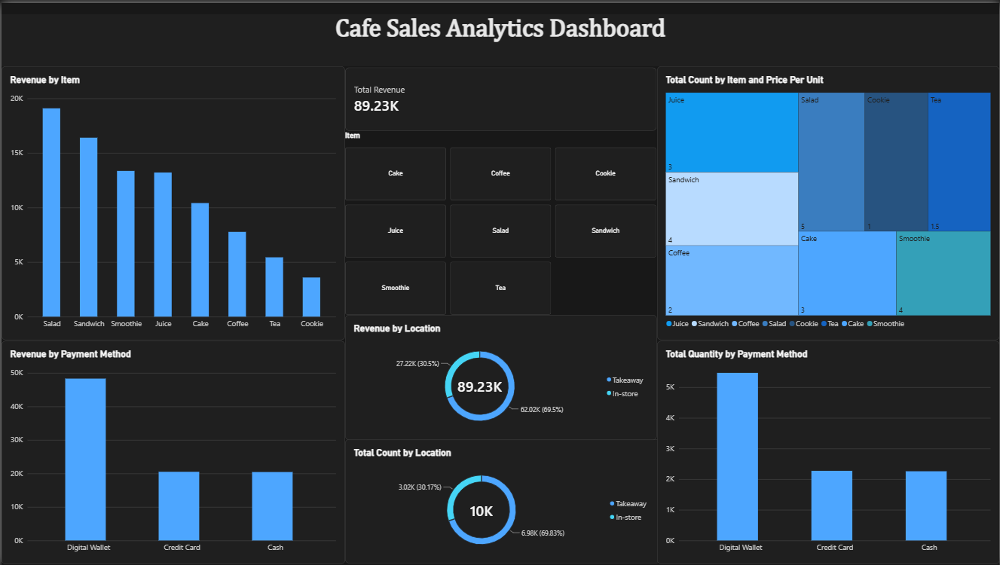

# Cafe Sales Analytics Data Pipeline & Dashboard



## Overview
This project demonstrates an end-to-end data engineering and business intelligence workflow. It processes raw, unstructured cafe sales data, applies advanced data imputation techniques to resolve missing and erroneous records, validates the output via SQL, and presents actionable insights through an interactive Power BI dashboard.

## Tech Stack
* **Data Engineering:** Python 3, Pandas, NumPy
* **Data Validation:** SQL Server
* **Business Intelligence:** Power BI

## Project Structure
```text
cafe-sales-analysis/
│
├── data/
│   ├── dirty_cafe_sales.csv            # Raw dataset containing missing/erroneous values
│   └── cafe_sales_10k_final.xlsx       # Fully processed and imputed dataset
│
├── scripts/
│   └── cafe_cleaning.py                # Python ETL pipeline
│
├── sql/
│   └── data_validation.sql             # SQL queries for data integrity checks
│
├── dashboard/
│   ├── Cafe_Sales_Analysis_Dashboard.pbix
│   └── dashboard_preview.png           # Dashboard screenshot
│
├── .gitignore
└── README.md
```

## Data Engineering Methodology
Instead of dropping rows with missing values (which compromises data volume) or hardcoding error strings, a robust data imputation pipeline (`cafe_cleaning.py`) was developed:
1. **Error Standardization:** Replaced placeholder text (`UNKNOWN`, `ERROR`, `Not Specified`) with standard `NaN` nulls.
2. **Bidirectional Imputation:** 
   * *Reverse Imputation (Price -> Item):* Mapped missing items based on the statistical mode of known unit prices.
   * *Forward Imputation (Item -> Price):* Mapped missing prices based on the median price of known items.
3. **Categorical Imputation:** Applied mode imputation for `Payment Method` and `Location` dimensions.
4. **Mathematical Coercion:** Reconstructed missing transaction quantities dynamically using `Total Spent / Price Per Unit`.
5. **Categorical Bucketing:** Unresolvable edge cases were cleanly bucketed into an `Others` category to maintain dashboard integrity without polluting dimensions.

## Dashboard Insights
The Power BI dashboard visualizes the cleaned dataset, providing strategic business metrics:
* **Total Revenue & Volume Tracking:** High-level KPIs tracking overall revenue ($89.23K) and total item count (10K).
* **Revenue by Item & Price Per Unit:** Treemap and bar chart analysis highlighting top-performing products (Salad, Sandwich, Smoothie).
* **Payment Channel Analytics:** Distribution analysis showing Digital Wallets as the dominant payment method over Credit Cards and Cash.
* **Location Distribution:** Donut charts splitting revenue and transaction volume between Takeaway and In-store orders.

## How to Run
1. **Execute the Data Pipeline:** 
   Navigate to the `scripts/` directory and run the Python script to generate the clean dataset.
   ```bash
   python cafe_cleaning.py
   ```
2. **Validate Data:**
   Run `data_validation.sql` against the generated output in SQL Server to ensure structural integrity and check for duplicates.
3. **View Dashboard:**
   Open `dashboard/Cafe_Sales_Analysis_Dashboard.pbix` in Power BI Desktop to interact with the final visualizations.